 

  

 

 

### `aryan@github ~ $ ls ./selected-work`

 

[WEBSITE](https://webteaconnect.vercel.app/) · [GITHUB](https://github.com/viratsingh862008-blip) · [INSTAGRAM](https://www.instagram.com/hum.bihari.ai/)

Born in Bihar. Built for what's next. · Paper / Ink / Blue / Red / Yellow

