  
    
  
  
  
    
  
    
  
    
  <h2>Selected work</h2>
  
  
  
    
  <a href="https://webteaconnect.vercel.app/">WEBTEA</a> · <a href="https://github.com/viratsingh862008-blip">GITHUB</a> · <a href="https://www.instagram.com/hum.bihari.ai/">INSTAGRAM</a>
   
  Born in Bihar. Built for what's next.

